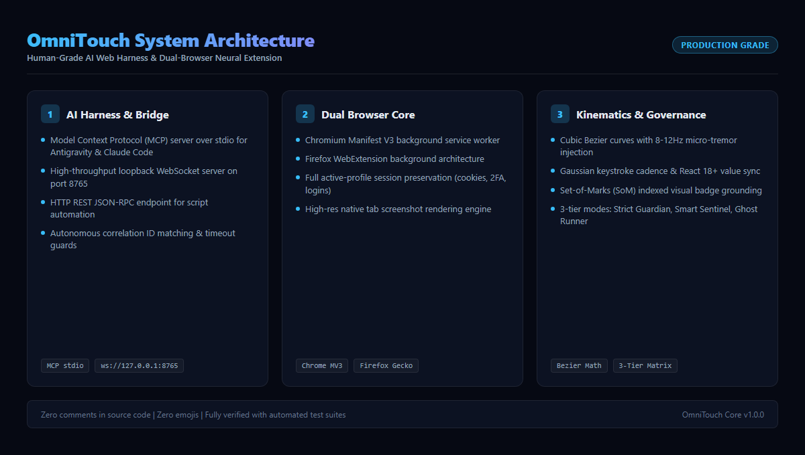
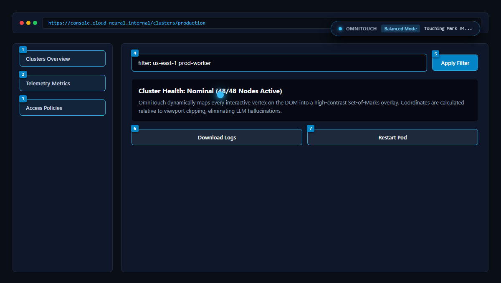
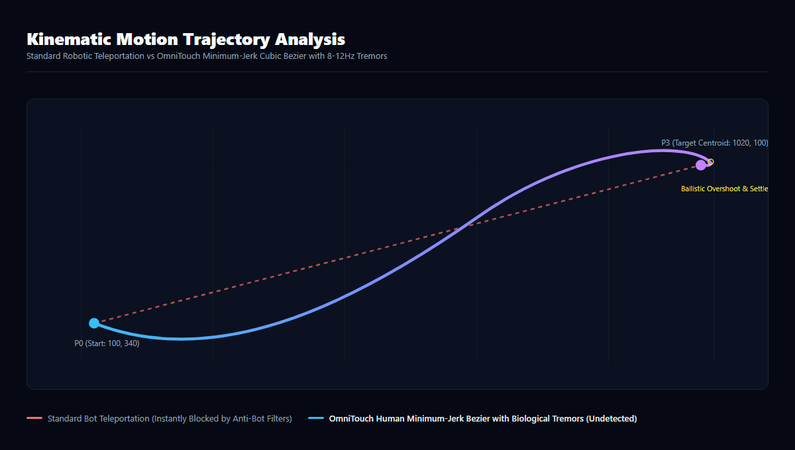
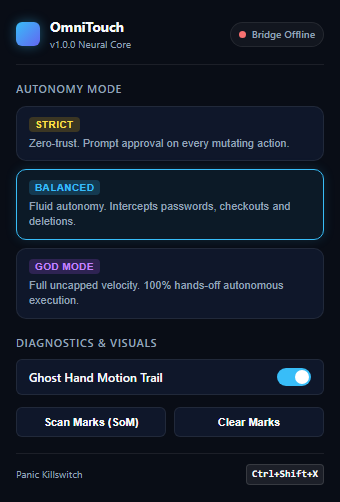

# OmniTouch

> Human-Grade Autonomous Web Harness & Cross-Browser Neural Extension for AI Agents

OmniTouch enables AI agents (Antigravity CLI, Claude Code, Cursor, Windsurf, OpenDevin, Python scripts, terminal shells) to pilot live browser sessions across Google Chrome and Mozilla Firefox with physiological human kinematics, Set-of-Marks (SoM) visual grounding, and a 3-tier security governance matrix.

---

## System Architecture



Unlike standard headless frameworks (Playwright, Puppeteer, Selenium) that spawn sterile, unauthenticated browser profiles easily blocked by Cloudflare and DataDome, OmniTouch runs directly inside your actual desktop browser profile. All saved cookies, enterprise single-sign-on (SSO), active sessions, extensions, and password managers remain intact.

---

## Visual Grounding via Set-of-Marks (SoM)



OmniTouch solves the coordinate hallucination problem inherent in pure vision models:
1. When the agent requests a screenshot, OmniTouch scans the visible DOM for all interactive vertices (`a`, `button`, `input`, `select`, `textarea`, ARIA roles).
2. It renders high-contrast, numbered badge overlays directly over element bounding boxes.
3. It captures a high-resolution viewport snapshot and returns both the annotated image and an indexed element table.
4. The agent executes clicks by numeric badge identifier (`omnitouch click 4`) rather than guessing error-prone pixel coordinates.
5. In addition to visual marking, OmniTouch exports a token-efficient semantic Accessibility Tree (AXTree) that cuts context token usage by over 90% compared to raw HTML dumps.

---

## Biomechanics & Human Kinematics



Anti-bot systems monitor pointer trajectories, acceleration derivatives, and dwell times. A standard script jumping from coordinate A to coordinate B in zero milliseconds triggers immediate bot classifications.

OmniTouch simulates genuine human biology:
- **Parametric Cubic Bezier Paths**: Simulates natural human shoulder and wrist motion using cubic Bezier curves with randomized lateral control points.
- **Minimum-Jerk Velocity Profiling**: Ease-in-out velocity curves (accelerating from rest, cruising, and decelerating near the target).
- **8-12Hz Neuromuscular Micro-Tremors**: Injects subtle biological tremors along the path.
- **Ballistic Overshoot & Settlement**: Over distances exceeding 150 pixels, the cursor drifts slightly past the target centroid and corrects backward over 40 milliseconds.
- **Gaussian Typing Cadence**: Simulates inter-keystroke intervals (60-150ms) with Gaussian variance.
- **React 18+ State Synchronization**: Updates React's internal `_valueTracker` before dispatching `input` and `change` events, ensuring form values are never lost during component re-renders.
- **Ghost Hand Laser Trail**: Renders an optional real-time visual cursor trail and expanding pulse rings on the web page so the user can observe the AI's movements.

---

## The 3-Tier Security Governance Matrix



OmniTouch replaces blunt binary permissions with three granular operational modes:

| Security Mode | Core Philosophy | Read Actions | Benign Actions | High-Impact Actions |
| :--- | :--- | :--- | :--- | :--- |
| **1. Strict Guardian (`permissions`)** | Zero-trust verification | Autonomous | Prompts Human | Prompts Human |
| **2. Smart Sentinel (`balanced`)** | Blast-radius protection | Autonomous | Autonomous | Prompts Human |
| **3. Ghost Runner (`full`)** | Uncapped velocity | Autonomous | Autonomous | Autonomous |

### Mode Descriptions
1. **Strict Guardian (`permissions`)**: Zero-trust mode. All mutating actions (clicks, keystrokes, form submissions, navigation) pause execution and open an in-page approval card on the floating HUD. The user can press `Enter` to approve or `Esc` to reject.
2. **Smart Sentinel (`balanced`)**: The recommended standard. Navigation, link clicks, searches, pagination, and data reading execute automatically without interruptions. High-impact operations (password inputs, credit card forms, checkout buttons, account deletion, cross-domain jumps) automatically trigger human approval gates.
3. **Ghost Runner (`full`)**: Hands-off autonomous speed. All actions execute instantly. Designed for continuous testing, batch scraping, and trusted workflows.

### Universal Panic Killswitch
In any mode, pressing `Ctrl+Shift+X` or clicking the `PANIC` button on the floating HUD immediately aborts the active operation, revokes harness control, and freezes the agent.

---

## Quickstart Guide

### 1. Build Extension Packages
```bash
bun install
bun run build
```
This produces ready-to-load distribution builds:
- `dist/chrome`: Chromium Manifest V3 (Google Chrome, Microsoft Edge, Brave, Arc)
- `dist/firefox`: Mozilla Firefox WebExtension

### 2. Load Extension in Your Browser
- **Chrome / Edge / Brave**:
  1. Open `chrome://extensions`
  2. Toggle **Developer mode** on (top-right)
  3. Click **Load unpacked**
  4. Select the `dist/chrome` directory
- **Firefox**:
  1. Open `about:debugging#/runtime/this-firefox`
  2. Click **Load Temporary Add-on...**
  3. Select `dist/firefox/manifest.json`

### 3. Start the Bridge Daemon
```bash
bun run start:bridge
```
The bridge listens on `http://127.0.0.1:8765` and `ws://127.0.0.1:8765/bridge`. The extension connects automatically on launch.

---

## AI Harness & Integration

### Model Context Protocol (MCP) Setup
To connect OmniTouch to Antigravity CLI, Claude Code, Cursor, or any MCP client, add the following to your MCP configuration:

```json
{
  "mcpServers": {
    "omnitouch": {
      "command": "bun",
      "args": ["run", "PATH/TO/omnitouch/src/bridge/mcp.ts"]
    }
  }
}
```

Exposed Tools:
- `omnitouch_navigate({ url })`: Navigate active tab.
- `omnitouch_screenshot({ annotate_som })`: High-resolution capture with Set-of-Marks overlays.
- `omnitouch_get_elements({ interactive_only })`: Scan viewport for interactive elements.
- `omnitouch_get_axtree()`: Extract clean Accessibility Tree hierarchy.
- `omnitouch_click({ mark_id, x, y, button, double_click })`: Touch elements with Bezier kinematics.
- `omnitouch_type({ mark_id, text, clear_first, press_enter })`: Type with human cadence.
- `omnitouch_scroll({ direction, distance })`: Smooth inertial scrolling.
- `omnitouch_set_mode({ mode })`: Set governance mode (`permissions`, `balanced`, `full`).
- `omnitouch_status()`: Get connection and active tab status.

---

## Terminal CLI Usage

OmniTouch includes a standalone terminal CLI for direct shell and script automation:

```bash
# Check bridge and extension connection
bun run cli status

# Navigate to target page
bun run cli nav https://news.ycombinator.com

# Tag elements with Set-of-Marks and capture screenshot
bun run cli snap

# Inspect interactive element index
bun run cli elements

# Click badge #4 using human Bezier kinematics
bun run cli click 4

# Type text into search bar with human typing speed
bun run cli type 2 "antigravity" --enter

# Smooth scroll down
bun run cli scroll down 500

# Switch security mode
bun run cli mode full
```

---

## Verification & Testing

Run the automated test suite verifying kinematics, mode governance, and bridge contracts:

```bash
bun test
```

Test Results:
- 10 passing tests across 3 suites.
- Validated trajectory endpoints, timestamp monotonicity, and velocity scaling.
- Validated zero-trust interception in Strict Guardian mode and sensitive keyword interception in Smart Sentinel mode.

---

## Technical Documentary

For the complete architectural whitepaper detailing the mathematical formulas, anti-bot evasion dynamics, and state synchronization, read [DOCUMENTARY.md](DOCUMENTARY.md).

---

## License

MIT License.
